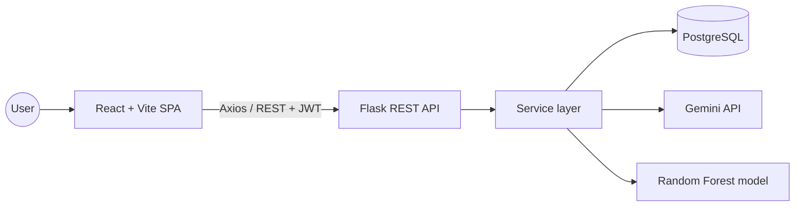
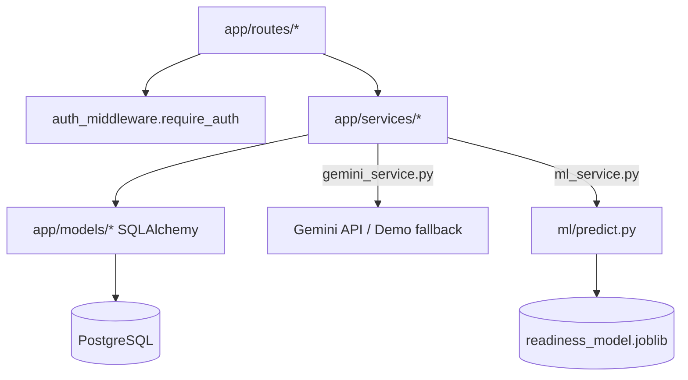
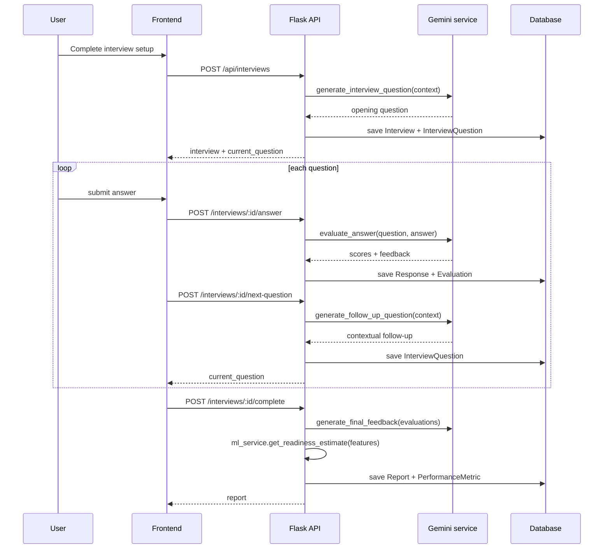

# Architecture

InterviewIQ is a **modular monolith**: one React frontend, one Flask
backend, one PostgreSQL database. This keeps the system easy to run,
debug, and explain, while still separating concerns cleanly through
routes → services → models.

## Why these choices (viva-friendly)

- **Why React + Vite?** Fast dev server, component reuse across the
  onboarding/interview/report flows, huge ecosystem (Framer Motion,
  Lucide, React Router) for a premium, animated UI without heavy setup.
- **Why Flask?** Lightweight, explicit, easy to structure into
  blueprints/services/models without hidden magic — good for a project
  that needs to be explained line by line.
- **Why PostgreSQL?** Relational integrity (foreign keys between users,
  interviews, questions, responses, evaluations) matters here — this is
  not a document-shaped problem.
- **Why Gemini?** A hosted, general-purpose LLM avoids the cost and
  complexity of training a model capable of natural conversation; it lets
  the project focus its own ML work on a problem better suited to
  classical ML (readiness classification from structured scores).
- **Why Random Forest for readiness?** The readiness signal comes from a
  handful of structured, moderately correlated numeric/categorical
  features — Random Forest handles that well, is robust to overfitting
  with sensible depth limits, and produces feature importances that are
  easy to explain.

## High-level request flow

## Backend internal structure

## Interview engine sequence

## Deployment shape

A single Flask process (gunicorn in production) serves the REST API; the
React app is built to static files and served separately (CDN/static
host or the same reverse proxy). PostgreSQL is the single source of
truth. No message queues, no microservices, no container orchestration —
intentionally, per the project's scope (see `docs/../PROJECT_GUIDE.md`
§15).
