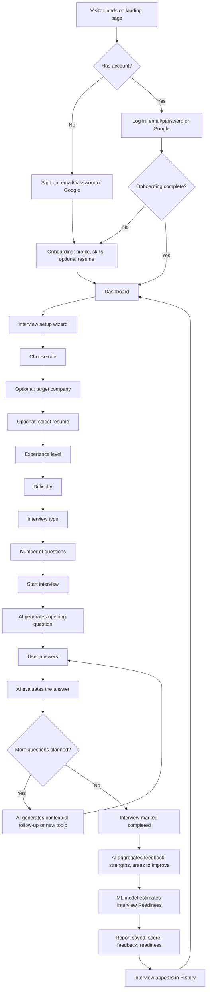

# User Flow

## Narrative walkthrough

1. **New user** discovers InterviewIQ via the landing page and clicks
   "Start your interview".
2. **Signup** via email/password or Google OAuth creates a `User` row and
   issues JWT access + refresh tokens.
3. **Onboarding** collects education, experience level, skills, and an
   optional resume upload — all steps except the account itself can be
   skipped and completed later from the Profile page.
4. **Resume** (if uploaded) is parsed into structured fields
   (skills, education, experience, projects, certifications) and stored;
   its summary is later injected into Gemini prompts for personalization.
5. **Interview setup** is a 7-screen sequential wizard rather than one
   long form: role → company (optional) → resume (optional) →
   experience → difficulty → type → question count.
6. **Interview** begins: the backend calls Gemini (or the demo fallback)
   for an opening question tailored to the chosen context. The user
   answers in a focused, distraction-free interview room.
7. **Follow-up**: after each answer is evaluated, the engine alternates
   between a contextual follow-up (referencing the candidate's own words)
   and a fresh topic, until the planned question count is reached.
8. **Evaluation**: every answer receives structured AI-generated scores
   (technical, communication, problem-solving, relevance, confidence).
9. **ML readiness**: on completion, aggregated scores are fed into the
   trained Random Forest model to produce an Interview Readiness Estimate.
10. **Report**: the final report combines the AI's qualitative feedback
    (strengths, areas to improve, summary) with the quantitative readiness
    estimate, and is permanently saved.
11. **History**: every past interview — in progress or completed — is
    listed, and clicking one reopens its report (or resumes it, if
    unfinished).
12. **Next practice**: the dashboard and report both point back to
    "Start new interview", closing the loop: discover → sign up →
    personalize → practice → adapt → evaluate → improve → repeat.
